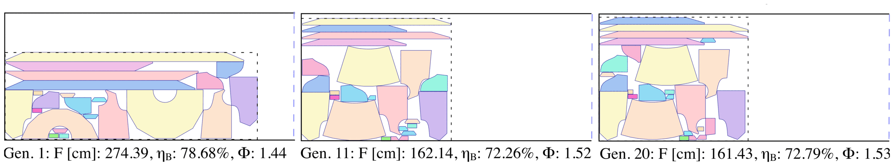
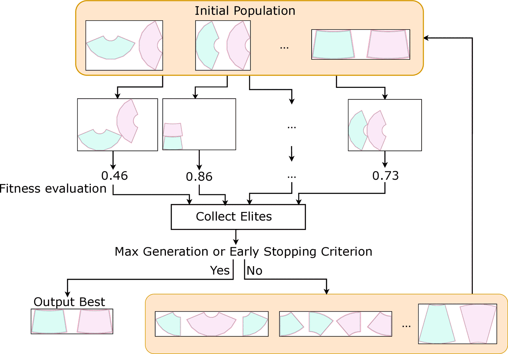
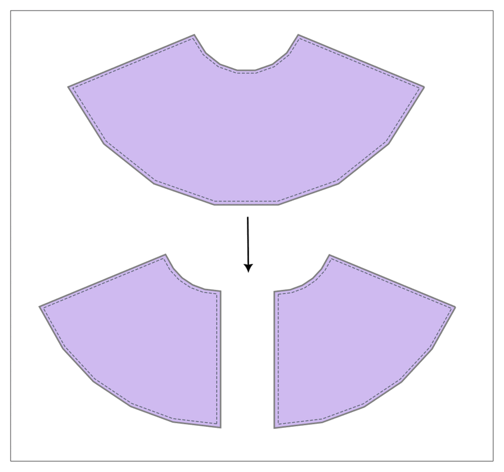
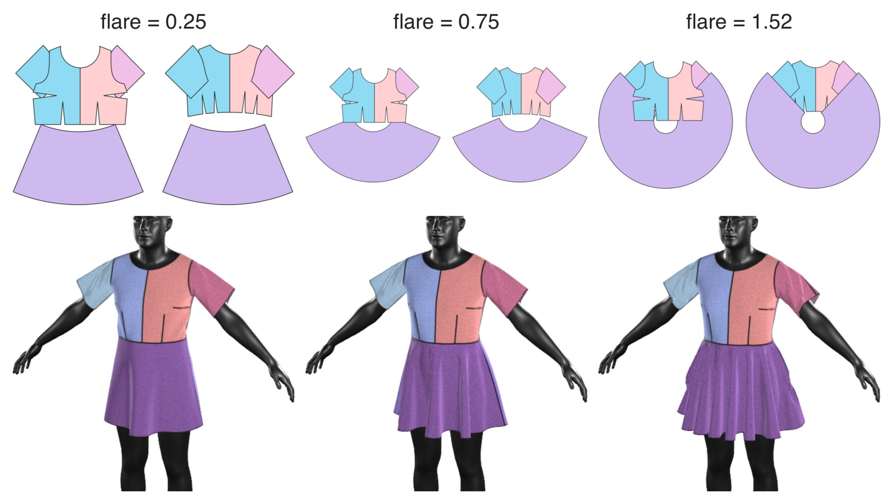
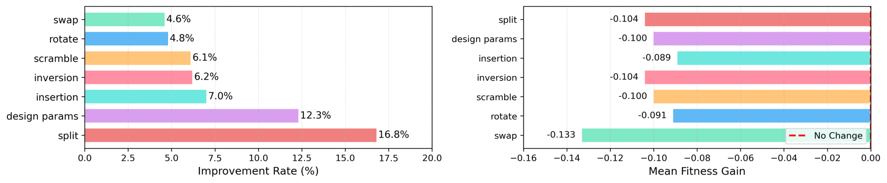

# FittedGenes: Domain-Aware Sewing Pattern Layout Optimization

Ayşegül Barlas, Maria Korosteleva

[](https://www.dgcv.org/gcpr-vmv-2026/)
[](#)
[](LICENSE)
[](docs/Installation.md)

<p align="center">
  
</p>

Nesting arranges garment panels on a fabric strip without overlap, minimizing the material consumed.
Every prior formulation treats panel geometry as fixed. **FittedGenes makes the garment design itself a
variable of the optimization**: panels may be split into stitchable sub-panels, and design parameters
may be re-sampled, both under constraints that preserve fit while letting appearance vary within
designer-set bounds. On 98 GarmentCodeData patterns this raises fill rate by 2.32 points and shortens
layouts by 12.06 cm (7.90%) over permutation-only search.

## Installation

Follow the GarmentCode [installation instructions](docs/Installation.md) (Python 3.9, plus a
`system.json` copied from `system.template.json`). The cloth simulator is needed only for 3D draping —
the nesting pipeline runs without it.

```bash
conda env create -f environment.yaml
conda activate garment
```

## Quick start

```bash
python -m nesting.gui        # nesting GUI at http://localhost:8082
```

It loads the pattern named in `nesting/config.py`; you can also upload a pattern JSON. To enable
design-parameter mutations, point `default_pattern_path`, `default_design_param_path` and
`default_body_param_path` in `SystemConfig` at your own files.

To start from the GarmentCode configurator instead, run `python gui.py`, design a garment, and click
**NEST** in the left toolbar. The search runs for several minutes and the page will appear to
disconnect while it does — leave the tab open, it refreshes itself with the final layout. See
[docs/Running_nesting.md](docs/Running_nesting.md).

## Reproducing the paper

The commands below regenerate the numbers in Tables 1 and 2 and every figure in the paper. Named
configurations (`ga_sticky`, `ga_lexicographic`, `ne_full`, `ne_no_rotations`, `ne_no_splits`,
`ne_no_params`, `ne_no_splits_no_params`, `two_exchange`, `random_search`, …) are defined in
`nesting/runners/run_all_experiments.py`; all algorithm settings are dataclasses in
[`nesting/config.py`](nesting/config.py).

```bash
# Main benchmark: 98 GarmentCodeData patterns x 5 runs  -> Tables 1 and 2
python -m nesting.runners.run_all_experiments garmentcode \
    --patterns-file nesting-assets/patterns_paper98.txt --n-runs 5

# ESICUP garment instances (Section 5.4)
python -m nesting.runners.run_all_experiments esicup --n-runs 5

# Decoder / placement-policy comparison
python -m nesting.runners.run_all_experiments decoder_comparison \
    --patterns-dir nesting-assets/pattern_files --n-patterns 1700

# NFP edge-sampling sweep
python -m nesting.runners.run_all_experiments nfp_sweep \
    --patterns-file nesting-assets/patterns_paper98.txt

# All figures and LaTeX tables
python -m nesting.analysis.generate_results \
    --runs-dir nesting/experiments/runs_fresh \
    --stats-file nesting-assets/pattern_stats_98.csv \
    --output-dir nesting/experiments/results
```

Results land in `nesting/experiments/runs_fresh/`, one CSV per group. Runs already present in a CSV are
skipped, so an interrupted sweep can simply be relaunched. Per-mutation, per-generation data is logged
to `mutation_data.csv` for the `ne_full` and `ne_no_rotations` configurations.

**Benchmark.** The 98 patterns are listed in `nesting-assets/patterns_paper98.txt`, sampled with a fixed
seed from the 3,450 patterns in `nesting-assets/pattern_files/`. GarmentCode runs use a 1 cm seam
allowance on 140 cm-wide fabric. ESICUP instances keep their native coordinate units, each with its own
fabric width, and use a seam allowance of 0.001 native units — exactly zero produces degenerate NFP
geometry. A single run takes a median of ~9 minutes on an M3 MacBook Pro (8 GB), driven by panel count
rather than generation count: a few minutes for 4-panel patterns, up to ~45 for 20-panel ones.

## Method

Solutions are chromosomes whose genes are panels carrying shape, rotation and placement order, plus the
garment's design parameters. Each generation keeps an elite pool, derives mutants and crossover
offspring from it, and injects random individuals for diversity. Candidates are decoded into layouts by
an NFP-based placement engine and scored with Φ = η_B + (L_max − F)/L_max.

<p align="center">
  
</p>

Two mutation operators exploit garment semantics:

* **Splits** divide a panel along a construction-aware cut line — cuts never bisect darts, and skirt
  cuts run parallel to the hemline normal. The two sub-panels are placed independently and stitched
  back in the finished garment, so a split changes where seams fall, not the silhouette.
* **Design-parameter mutations** exploit GarmentCode's separation of *body* parameters (the wearer's
  measurements) from *design* parameters (flare, hem length, neckline depth). Re-sampling a design
  parameter within a user-set margin regenerates every panel that depends on it, consistently and
  without introducing seam mismatches. Body measurements never enter the search space.

<p align="center">
  
  
</p>

Alongside these, **Cross-Stitch Crossover (CSX)** is a variable-length OX variant that respects split
integrity and design-parameter consistency, and the **policy-based objective** generalizes the classical
strip-packing criterion to strip, bounding-box and concave-hull notions of used fabric.

## Results

98 GarmentCodeData patterns, 5 runs each. *F* is occupied strip length (cm); *η_B* and *η_H* are
bounding-box and concave-hull fill rates (%); Φ is the combined objective.

| Method          |   F ↓  |  η_B ↑ |   Φ ↑  |  η_H ↑ |
|-----------------|-------:|-------:|-------:|-------:|
| GA (sticky)     | 141.43 |  80.34 | 1.6266 |  84.37 |
| GA (lex.)       | 140.33 |  80.24 | 1.6270 |  84.33 |
| **NE (full)**   | **137.27** | **80.48** | **1.6332** | **84.39** |
| 2-Exchange      | 164.27 |  77.17 | 1.5664 |  82.59 |
| Random Search   | 152.69 |  76.32 | 1.5723 |  82.05 |

Naive evolution — mutation only, no crossover — beats the full GA, implying a rugged loss landscape.
Both proposed operators are individually necessary and mutually complementary; ablations are in Table 2
of the paper.

<p align="center">
  
</p>

Split (16.8%) and design-parameter (12.3%) mutations succeed far more often than the classical
permutation operators and contribute most of the total progress.

## Repository layout

The nesting contribution lives entirely under [`nesting/`](nesting/):

| Path | Contents |
|------|----------|
| `nesting/search/` | GA and naive evolution (`evolution.py`), chromosome encoding, mutation and crossover operators (`operations.py`), 2-exchange and random-search baselines, simulated annealing |
| `nesting/placement/` | Decoders: bottom-left heuristic and the NFP placement engine with its scoring policies |
| `nesting/core/` | Layout representation, geometry helpers, parameter handling |
| `nesting/data/` | Pattern loading, panel↔design-parameter mapping, path extraction |
| `nesting/runners/` | Experiment runners, including the master runner used for the paper |
| `nesting/analysis/` | Figure and table generation, mutation-effectiveness and metric-correlation analysis |
| `nesting/gui/` | Interactive nesting GUI (NiceGUI) |
| `nesting-assets/` | Benchmark pattern list, ESICUP instance specs, default body and design parameters |

Everything else (`pygarment/`, `assets/`, `docs/`) is upstream GarmentCode.

## Citation

```bibtex
@inproceedings{FittedGenes2026,
  author    = {Barlas, Ay{\c{s}}eg{\"u}l and Korosteleva, Maria},
  title     = {{FittedGenes}: Domain-Aware Sewing Pattern Layout Optimization},
  booktitle = {Vision, Modeling, and Visualization},
  year      = {2026},
  publisher = {The Eurographics Association},
}
```

If you use the pattern representation or the GarmentCodeData-derived benchmark, please also cite:

```bibtex
@article{GarmentCode2023,
  author = {Korosteleva, Maria and Sorkine-Hornung, Olga},
  title = {{GarmentCode}: Programming Parametric Sewing Patterns},
  year = {2023},
  issue_date = {December 2023},
  publisher = {Association for Computing Machinery},
  address = {New York, NY, USA},
  volume = {42},
  number = {6},
  doi = {10.1145/3618351},
  journal = {ACM Transaction on Graphics},
  note = {SIGGRAPH ASIA 2023 issue},
  numpages = {16},
  keywords = {sewing patterns, garment modeling}
}

@inproceedings{GarmentCodeData:2024,
  author = {Korosteleva, Maria and Kesdogan, Timur Levent and Kemper, Fabian and Wenninger, Stephan and Koller, Jasmin and Zhang, Yuhan and Botsch, Mario and Sorkine-Hornung, Olga},
  title = {{GarmentCodeData}: A Dataset of 3{D} Made-to-Measure Garments With Sewing Patterns},
  booktitle={Computer Vision -- ECCV 2024},
  year = {2024},
  keywords = {sewing patterns, garment reconstruction, dataset},
}
```

## Upstream GarmentCode

This repository builds on [maria-korosteleva/GarmentCode](https://github.com/maria-korosteleva/GarmentCode),
the official implementation of *GarmentCode* and *GarmentCodeData*, which supplies the parametric
pattern representation the mutation operators act on. An online configurator is available at
[garmentcode.ethz.ch](https://garmentcode.ethz.ch/). Its documentation is unchanged here:
[Installation](docs/Installation.md) ·
[Configurator](docs/Running_garmentcode.md) ·
[Data generation](docs/Running_data_generation.md) ·
[Nesting](docs/Running_nesting.md) ·
[Maya + Qualoth](docs/Running_Maya_Qualoth.md) ·
[Dataset](https://www.research-collection.ethz.ch/handle/20.500.11850/673889)

[PyGarment](pygarment/) is the core upstream library; `assets/garment_programs/` holds garment
components written with it, and `assets/design_params/`, `assets/bodies/` hold presets. Body
measurement extraction lives in [GarmentMeasurements](https://github.com/mbotsch/GarmentMeasurements).

## Contact

Issues and questions about the nesting method belong here; questions about GarmentCode itself belong on
the [upstream tracker](https://github.com/maria-korosteleva/GarmentCode/issues).

## License

MIT — see [LICENSE](LICENSE). GarmentCode is © Maria Korosteleva.
